<h1 align="center"> Soulgent</h1>

<p align="center"><b>Give your agents a soul.</b><br>Every session, a companion you can see.</p>

<p align="center"><a href="README.zh-CN.md">简体中文</a></p>

<p align="center">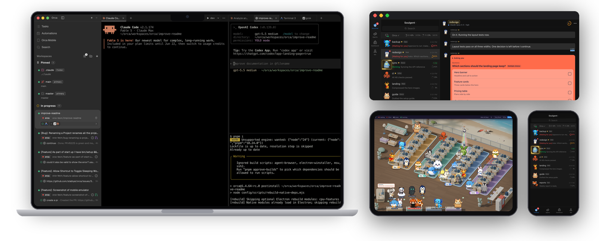</p>

<details>
<summary><b>A note from the author: why I built Soulgent</b> (click to open)</summary>

<br>

In Claude Code, Codex, WorkBuddy and tools like them, every piece of work starts the same way: you open a session in a terminal or an app. I like to give each session one kind of job. One looks after my VPS, one plays a phone game for me, one keeps my inboxes in order...

The longer I worked this way, the more sessions I had. Once I taught my Claude Code sessions to message each other, managing the sessions themselves became the bottleneck. Finding one thing meant digging through many sessions. At first I could keep track of three or four; whenever I focused on one task, the rest were forgotten.

I noticed other people trying to solve the same problem. On Reddit, someone wired up a physical warning light; someone else put a little virtual character on their iPhone as a reminder. That was when I realized I needed a better way to work alongside agents, because what slows down people and agents working together is often us, the humans.

Many great products today are building one all-powerful super assistant. My habit is different: **one session, one kind of job.** Each session keeps the context of its own corner of the work, and gets better at it the longer it runs.

Later I had more than 40 long-running sessions, and even a dashboard could not keep up. So I split them into 4 agent teams, each with a Leader who organizes most of the collaboration. There may be more teams one day, and maybe a "vice president" to manage the Leaders. Soulgent's three scenes grew out of this step by step: the **Duty Room** for handling things fast, the **Office** where companions walk up to my desk to report, and **Seaview**, where each team sits together.

In real life we have many friends and work with many colleagues. One day we will have many agents too. I want sessions to step out of terminals and chat boxes, so that living with a crowd of agents feels as natural as living among people you know.

</details>

## What is Soulgent

Soulgent turns every agent session on your computer into a character with a name, a look and a mood. Who is working, who is done and has something to tell you, who is waiting for your decision: one glance up and you know. Seeing every session works on its own; clicking a character to jump to its session and replying from your phone work together with [Orca](#credits).

They sit at their desks while they work. When they are done and have something to report, they wait on the sofas; when they need your decision, they walk up to your desk, queue and knock. Keep the whole crew on an iPad, seated by team in one seaside office, and answer them from your iPhone like texting a friend.

Soulgent has two parts that share one live picture of your sessions:

- **Soulgent for Mac** is a native menu-bar app with a floating window you can keep open on an iPad. Look up and you see how every companion is doing. Lives in `app/`, build from source.
- **Soulgent App** (mobile web app) is a web app you add to your iPhone home screen; its chat page is called SoulChat. Away from your desk, you answer them like a chat. Lives in `webapp/`, runs on your Mac in Docker.

<br>

## Click to jump

Click any character and Orca jumps straight to its session, stamping the session name across the pane so you never pick the wrong one. The setup I recommend: Orca on the big screen, Seaview on an iPad right below it (macOS Sidecar), Soulgent App on your phone. No iPad? Keep Soulgent's floating window in a corner, or open Soulgent App in a desktop browser.

<picture><source srcset="docs/media/setup-jump.webp" type="image/webp">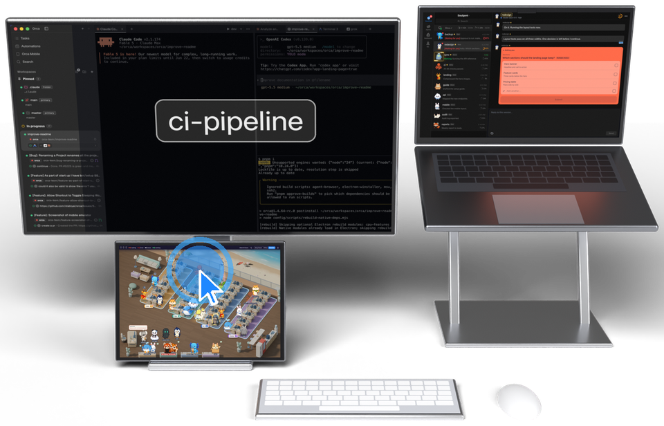</picture>

## Seaview

A seaside office rendered in Blender, with four islands for four teams.

### One room for every session

Every session on your Mac is a character in one seaside office, sitting on its team's island. The Leader always takes desk 1 at the front. When an island is full, the rest go to the lounge and the team sign shows +N. The session you are typing in, in [Orca](#credits), gets a disco ball overhead; switch tabs and it follows.

<picture><source srcset="docs/media/seaview-spotlight.webp" type="image/webp">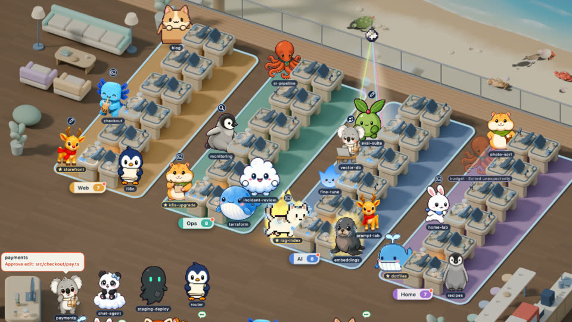</picture>

### Queuing and knocking at your desk

A session that needs your decision walks to your desk and joins the queue, with a note above its head saying what it is waiting for, and knocks every 3 seconds. Once you answer, it walks back and the next one steps up.

<picture><source srcset="docs/media/seaview-queue.webp" type="image/webp">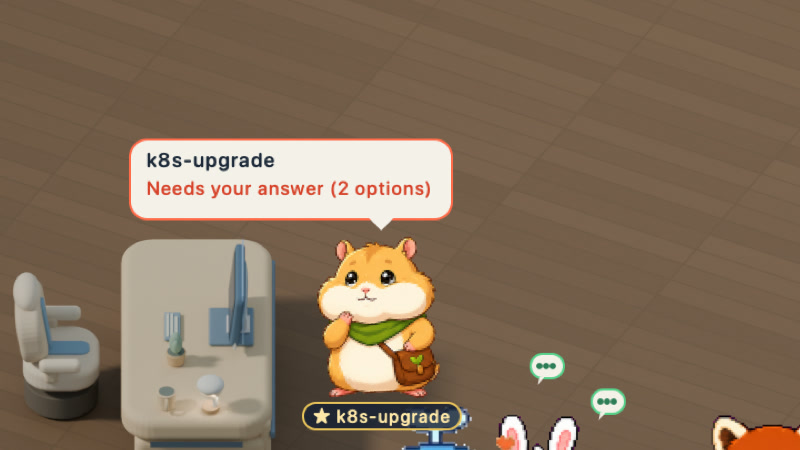</picture>

### Sub-agents at the desk

When a session sends out sub-agents, each one shows up as a little figure busy beside its desk, and leaves when its job is done. A badge overhead shows which tool the session is using.

<picture><source srcset="docs/media/seaview-desk.webp" type="image/webp">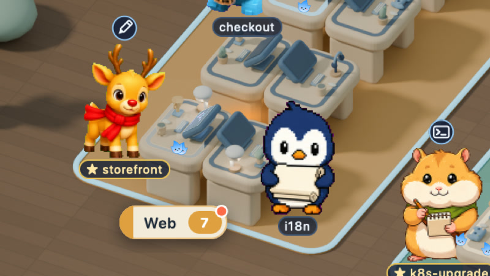</picture>

### Blaze Mode

Only sessions running a Fable model catch fire, so one glance tells you how many Fable sessions are running. While one works it is wrapped in flame and lightning; when it goes idle, only a glow is left.

Soulgent checks whether a session's model name contains "fable" (in any case), and only for Claude Code sessions. The Blaze Mode switch in Settings turns it off; it is on by default.

<picture><source srcset="docs/media/seaview-blaze.webp" type="image/webp">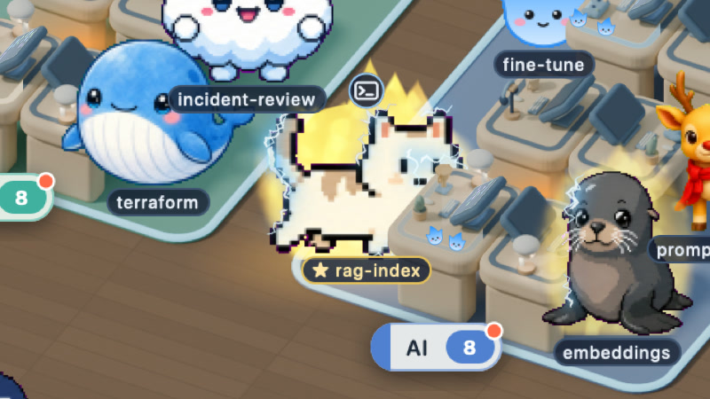</picture>

### The orca and the beach

Every few minutes an orca lunges onto the beach. Crabs, sandpipers and turtles wander the sand on their own and scatter when it comes; gulls fly overhead.

<picture><source srcset="docs/media/seaview-orca.webp" type="image/webp"></picture>

### Visiting

When two sessions message each other, the sender gets up and walks to the other's desk, the first line of its message above its head from the moment it sets off.

<picture><source srcset="docs/media/seaview-visit.webp" type="image/webp">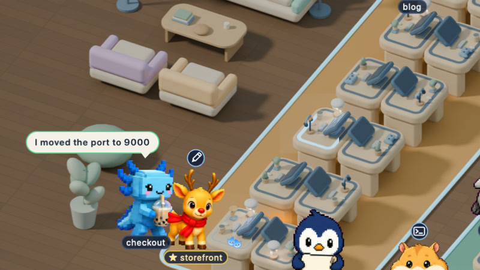</picture>

### Off duty, check-in, changing seats

A session sent off duty becomes an "off duty" count on its team sign; click it to call the session back. New sessions without a team stand at the check-in spot. Drag anyone to another desk, or right-click to give them a different character.

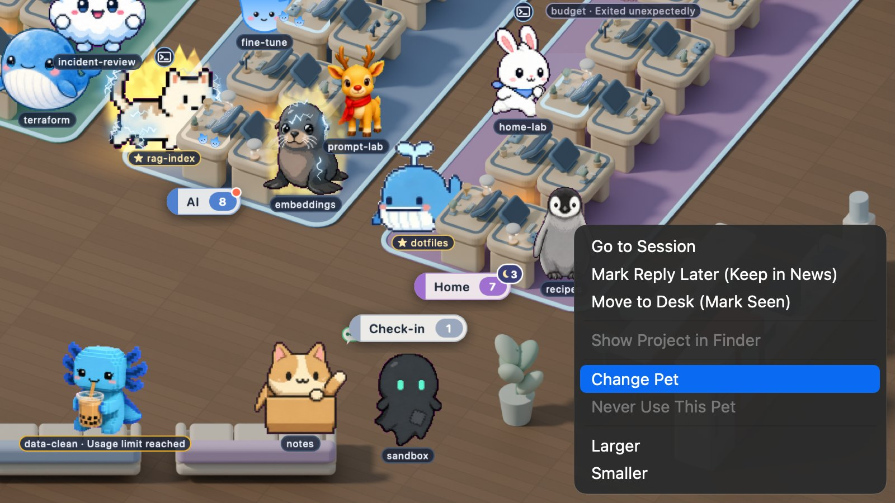

## Office

The Office and the Duty Room are two simpler scenes, made for anyone who does not need teams. Neither of them groups sessions by team.

When a session finishes, it hops at its desk and walks to the sofa to wait with its news. Sessions that need you line up at your desk.

<picture><source srcset="docs/media/office.webp" type="image/webp">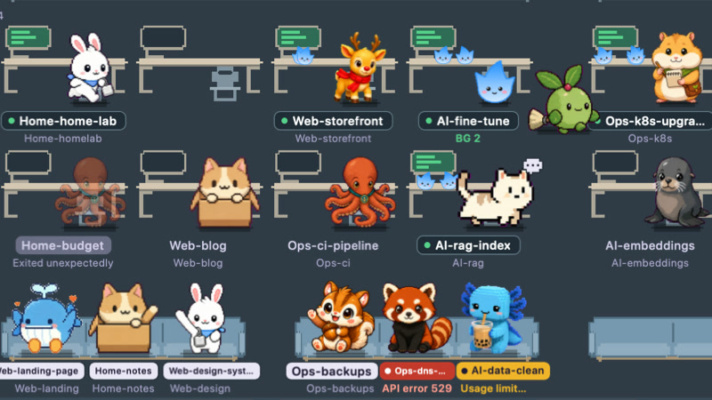</picture>

The back wall keeps a log of who finished, who is asking you and who talked to whom; hover over a figure to see its card.

## Duty Room

One card per session, grouped by what it needs from you. When a session changes state its card moves to the new group, and a paper plane flies when one session messages another.

<picture><source srcset="docs/media/duty-room.webp" type="image/webp">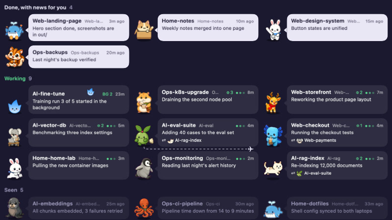</picture>

A waiting card spells out the command to approve or the question it asked. Make the window narrow and it turns into an inbox column; start typing to search.

## Soulgent App (mobile web app)

### Knocking when it needs you

A session waiting for your decision knocks in the list and turns red, so it stands out even in a long list. The ring at the end of each row shows how full its context window is. A session that belongs to no team is tagged "No zone", and while it works its pet steps out of the avatar and strolls along the row.

<picture><source srcset="docs/media/soulchat-knock-close.webp" type="image/webp">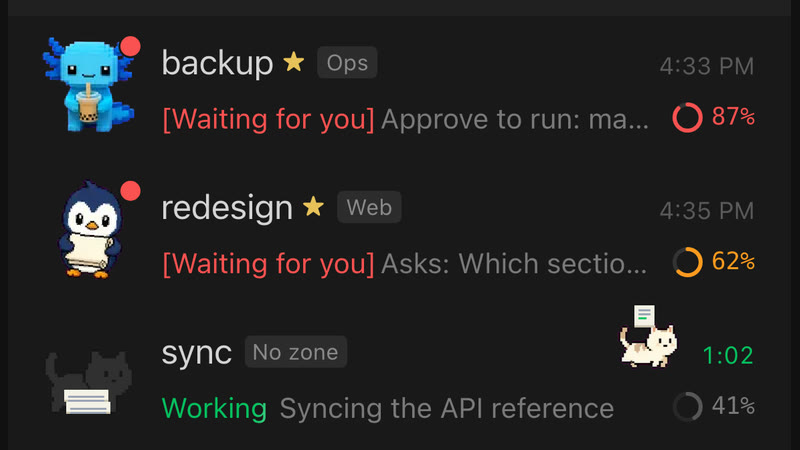</picture>

### Every team has its own effect

While a session on a team works, its avatar plays that team's effect: orbit, marquee, halo or circuit, set by `fx` in the [team table](#teams). Leaders and members look the same, apart from the ★ after a Leader's name.

<picture><source srcset="docs/media/soulchat-zone-fx.webp" type="image/webp">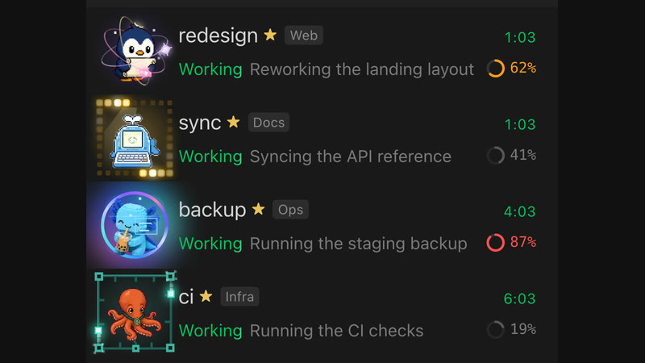</picture>

### Watch it work

While a tool runs, a little character climbs onto the chat bubble and walks along it; when the tool finishes it ticks and hops off.

<picture><source srcset="docs/media/soulchat-tools-close.webp" type="image/webp">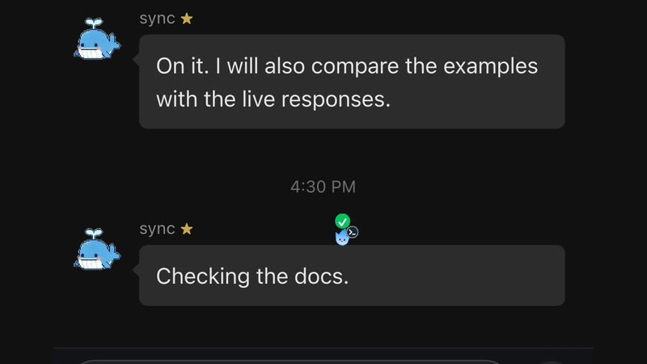</picture>

### Flip to see its sub-agents

When a session sends out sub-agents, tap that message and it flips over to a card for each one, with its state and how long it ran. Tap again to flip back.

<picture><source srcset="docs/media/soulchat-agents-flip.webp" type="image/webp">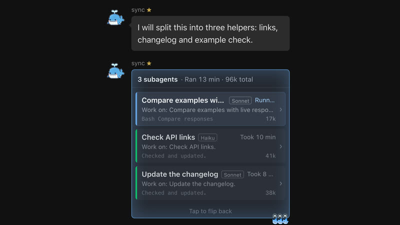</picture>

Replying, answering its questions and approving commands all happen in the conversation, and you can send photos and files both ways. Notifications ring only on the device you are using. In a desktop browser it opens in two columns.

> **For now, Soulgent App can only reply to Claude Code sessions** (running in Orca). For Codex and WorkBuddy sessions, Soulgent App shows their state and summary only: no full conversation, no replies yet.

It runs on your own Mac (in Docker) and is reached over HTTPS on your local network. The one thing that leaves your network is push notifications, which go, encrypted, through Apple's or Google's push service. Anyone with the admin key can type into your sessions, so read the security model in [`webapp/README.md`](webapp/README.md) before you set it up.

## Platforms

| | Soulgent for Mac | Soulgent App (web app) |
|---|---|---|
| macOS | Native app | The server runs here (Docker); also works in a desktop browser |
| iPhone / iPad | Use an iPad as a Mac display (Sidecar) | Add to Home Screen, with push notifications |
| Android | - | Open in the browser (no native app) |
| Windows | Not supported | Open in a browser on the same network; the server still needs a Mac |

Both parts come in English, Simplified Chinese and Traditional Chinese, following your system language.

## Requirements

Required:

- macOS 14 Sonoma or later, Apple Silicon. Earlier versions are untested.
- Xcode Command Line Tools, for `git clone` in Step 1 and for building; you do not need the full Xcode. Run `xcode-select --install` and click Install (it asks for your admin password and takes a few minutes); it is ready when `xcode-select -p` prints a path. With no screen to click, for example an AI installing over SSH, run `xcode-select --install` once anyway (that makes the update appear), then `softwareupdate --list` and `sudo softwareupdate -i "<the Command Line Tools label>"`. Future releases will ship a prebuilt app.
- [Claude Code](https://claude.com/claude-code). Soulgent installs without it, but the room stays empty until you have sessions.
- Node.js 20 or later (the LTS is fine), to install characters with [Petdex](https://petdex.dev): the installer from [nodejs.org](https://nodejs.org) (asks for your admin password), or `brew install node` if you use Homebrew. Open a new Terminal window afterwards so `npx` is found. Step 2 of Install uses it.

Optional, and what each adds:

| Install | What you get |
|---|---|
| [Orca](#credits) | Click-to-jump and Spotlight for Claude Code sessions; replying, answering questions and approving commands from Soulgent App (if Orca is closed, messages queue until it opens) |
| Codex, WorkBuddy | Their sessions appear in Soulgent for Mac and Soulgent App too, and open in their own apps when clicked; on the phone you see their state and summary, but not the full conversation, and cannot reply |
| Docker | Running Soulgent App |

## Install

Four steps: install the app, add characters, set up your teams, open Seaview. Soulgent App for your phone is optional and comes after.

Soulgent runs from the folder you clone it into, and its login item points there. Clone it somewhere permanent, not into Downloads, Desktop or Documents. If you move it later, run `tools/install.sh` again from the new place, with the same `--finder` and `--root` options.

### Recommended: let Claude Code or Codex do it

If you already use Claude Code or Codex, open it in the folder where you keep your code and paste this:

```text
Install Soulgent for me by following the Install section of https://github.com/Ericcc0321/soulgent
Check the requirements first and install only the required ones that are missing; ask me before any step that needs my password.
Before step 1, ask me where my projects live, whether I want Finder tags, and whether I use Orca.
Do all four steps, including the recommended characters.
For step 3, ask me how I want to split my sessions into teams (up to four) and who leads each one, then write ~/.claude/workzones.json and show me how to name my sessions.
At the end, ask me whether I also want Soulgent App on my phone.
```

The same steps by hand:

### Step 1: install the app

```bash
git clone https://github.com/Ericcc0321/soulgent.git
cd soulgent
app/build.sh                # build Soulgent.app
tools/install.sh --finder   # start now and at login, with Finder tags (leave out --finder to skip them)
```

The build takes a few minutes and prints a lot of compiler warnings; that is normal. It worked if the last line is `built Soulgent.app`. To check that Soulgent is running, `pgrep -x Soulgent` should print a number.

Finder tags look for projects in `~/Projects`, `~/Developer` and `~/code` by default (the installer tells you if none of them exists); point them elsewhere with `tools/install.sh --finder --root <folder>` (repeat `--root` for more). Folders inside Documents, Desktop or Downloads are protected by macOS and cannot be tagged from the background; keep projects elsewhere, such as `~/Projects`.

Spotlight needs [Orca](#credits). When you turn it on (from the menu bar menu or Settings), macOS asks you to allow Soulgent in **System Settings > Privacy & Security > Accessibility**. Without Orca you never need this permission. To remove Soulgent, see [Uninstall](#uninstall).

### Step 2: add characters

Soulgent comes with one character of its own, the Soulgent flame; the fun is in the rest. This installs the author's own set from [Petdex](https://petdex.dev), listed in [`examples/pets.txt`](examples/pets.txt) (about 175 MB, a minute or a few; edit the list to taste):

```bash
tools/install-pets.sh
```

Petdex has over 5,000 more; add any of them by id with `npx -y petdex@latest install <id> <id> ...`. Characters go into `~/.petdex/pets/`, and Petdex puts a second copy in `~/.codex/pets/` for Codex (about 350 MB in all). New ones appear within a minute. Petdex sends anonymous usage stats by default; turn them off with `npx petdex telemetry off`.

<a id="teams"></a>
### Step 3: set up your teams

Seaview seats sessions by team. Skip this and every session ends up at the check-in spot in the corner, so do it before you open Seaview. In the config a team is called a **work zone**, or zone for short. Each team has a **Leader** at desk 1, with members at desks 2 to 12.

1. **Name sessions `zone-system-task`**, for example `Web-auth-flow` or `Docs-api-reference`. Use `claude --name` when starting, or `/rename` inside a session. The part before the first `-` must match a zone key in the zone table exactly (case-sensitive).
2. **Write a zone table at `~/.claude/workzones.json`.** Start from [`examples/workzones.example.json`](examples/workzones.example.json), then replace the example teams with your own and delete the ones you do not need:

   ```bash
   mkdir -p ~/.claude
   cp examples/workzones.example.json ~/.claude/workzones.json
   ```

   The example looks like this:

   ```json
   {
     "default": null,
     "zones": {
       "Web":   { "name": "Web",   "color": "#4A90D9", "order": 1, "lead": "Web-lead",  "fx": "orbit" },
       "Docs":  { "name": "Docs",  "color": "#E0A030", "order": 2, "lead": "Docs-lead", "fx": "marquee" },
       "Infra": { "name": "Infra", "color": "#A070D0", "order": 3, "lead": null,        "fx": "halo" },
       "Ops":   { "name": "Ops",   "color": "#50B080", "order": 4, "lead": null,        "fx": "circuit" }
     },
     "dirs": {
       "~/code/docs-site": "Docs"
     }
   }
   ```

   - `lead`: the full session name of the team's Leader, exactly. If the Leader is offline or not set (`null`), desk 1 stays empty.
   - `name`: the name on the team sign. Seaview first looks for an island with the same name (the islands are drawn as Web, Ops, AI and Home).
   - `dirs`: sessions whose names have no recognizable prefix are assigned by project directory (longest prefix wins). `~` means your home folder; there are no wildcards. Write `{}` or leave it out if you do not need it.
   - `default`: the zone to use when `dirs` does not match either; `null` means no zone. Sessions without a zone go to the check-in spot in the corner; those waiting for you still queue at your desk.
   - `color`: the colour of the team sign. `order`: teams whose `name` matches no island take the free islands in this order.
   - `fx`: the effect this team's avatars play in Soulgent App while they work: `orbit`, `marquee`, `halo` or `circuit`. Leave it out and the pet walks out of its avatar instead.
3. **Optional: open your Claude Code sessions in [Orca](#credits).** Spotlight and click-to-jump rely on it (Spotlight also needs the Accessibility permission). Codex and WorkBuddy sessions jump through their own apps and do not need Orca.

Seaview has four islands, so it shows at most four teams (later versions may add more):

- With fewer than four, empty islands get a sign showing 0.
- With more than four, teams from the fifth on are not shown for now.
- Each team has at most 12 desks; anyone beyond that goes to the lounge, and the sign shows +N.

The Duty Room and the Office do not group by team. Soulgent picks up changes to the table within a few seconds; no restart needed.

**Common silent mistakes**: these do not raise an error, they just do not work.

- Invalid JSON: the whole table is treated as empty.
- `zones` written as an array: no session gets a zone.
- `color` not a 6-digit hex: the sign turns grey.
- `order` written as a string: the zone goes last.
- `lead` with only part of the name: desk 1 stays empty.

### Step 4: open Seaview

Soulgent first opens in the Duty Room, in a small window. Drag the window bigger (about 860 wide and 550 high is enough), then pick **Seaview** in the switch at the right of the title bar, or in the menu bar menu (it shows "needs a bigger window" while the window is too small). Start a Claude Code session named after one of your teams (in Orca or any terminal), say `Web-auth-flow` if you kept the Web team, and within a few seconds it walks to that team's island. To keep Seaview in view, drag the window onto an iPad used as a second display (Sidecar); it remembers that screen and goes back there when the iPad reconnects.

No screen to click, for example an AI installing over SSH? These switch to Seaview from the command line (the theme's id is its Chinese name, 海景房; type it as is). The window still has to be big enough, and that needs someone at the screen to drag it:

```bash
defaults write io.github.ericcc0321.soulgent officeTheme 海景房
defaults write io.github.ericcc0321.soulgent office -bool true
launchctl kickstart -k gui/$(id -u)/io.github.ericcc0321.soulgent
```

<a id="uninstall"></a>
### Uninstall

`tools/uninstall.sh` alone only quits Soulgent and removes its login items. To remove everything, run these from the `soulgent` folder, in this order:

```bash
python3 tools/finder/finder_sessions.py --restore   # only if you used --finder; it needs the data folder, so run it first
tools/uninstall.sh                                  # quit Soulgent and remove the login items
rm -rf ~/Library/Application\ Support/Soulgent ~/Library/Caches/io.github.ericcc0321.soulgent
defaults delete io.github.ericcc0321.soulgent
rm -f ~/Library/Preferences/io.github.ericcc0321.soulgent.plist
```

Then delete the `soulgent` folder. The characters stay, because Petdex and Codex use them too: delete `~/.petdex/pets` if you no longer want them, and `~/.codex/pets` only if you do not use Codex pets. `~/.claude/workzones.json` is yours to keep or delete.

## Install Soulgent App (optional)

Needs Docker. The server runs on the same Mac as Soulgent.

```bash
cd webapp
cp .env.example .env        # fill in the admin key, your Mac's LAN IP, etc.
docker compose up -d
bash helper/install.sh      # the helper reads session state on the Mac for Soulgent App
/usr/bin/python3 -m pip install --user Pillow   # once: the pet slicer runs on the Mac's own Python
/usr/bin/python3 tools/build_pets.py            # slice installed Petdex pets into data/pets/
```

Without the last two steps every avatar falls back to the built-in Soulgent flame. Re-run `build_pets.py` after installing new pets; details in [webapp/docs/pets.md](webapp/docs/pets.md).

Then trust the root certificate on your iPhone and add Soulgent App to the Home Screen. Full steps and every setting are in [`webapp/README.md`](webapp/README.md).

## How it works

- Sessions: every 2 seconds Soulgent reads Claude Code's list of running sessions in `~/.claude/sessions/`, and reads the tail of a transcript in `~/.claude/projects/` when it changes. These are Claude Code's internal formats, so a Claude Code update can break them.
- Codex and WorkBuddy: read-only access to their own local databases while their apps are running.
- Spotlight and click-to-jump: local communication with Orca. The Accessibility permission is used only to read Orca's tab bar.
- Teams (work zones): from `~/.claude/workzones.json`; see [step 3 of Install](#teams).
- Logs and data: in `~/Library/Application Support/Soulgent/`.
- Network: Soulgent for Mac makes no network requests while it runs, apart from talking to Orca on your Mac. Soulgent App is served on your own local network; only push notifications leave it, encrypted, through Apple's or Google's push service. Installing downloads from GitHub, npm (Petdex) and Docker Hub. Petdex sends anonymous usage stats unless you run `npx petdex telemetry off`.

## Team collaboration: how I do it (for reference)

This part is borrowed from eisen0419's [Claude Code workflow guide](https://gist.github.com/eisen0419/7301766c8e4f8d94315ba603deb74154); on top of it I run a fairly simple setup that I am still working out, and there are many people in the community doing this far better. If you want your sessions to hand work to each other, this is just one place to start. Soulgent reads only the off-duty roster, and only when you tell it where the roster is (the `rosterFile` setting or the `SOULGENT_ROSTER_FILE` environment variable); it reads none of the rest.

- A global `CLAUDE.md`: who you are, how you like to communicate, and what must be asked first.
- An output style: the author's makes every reply lead with the conclusion and put decisions for you into pop-up choices, which is what lets Soulgent show a session as "waiting for you". A reply line that starts with `〔进度〕` ("progress") becomes that session's one-line status on its card.
- Handoff documents: each project has a `HANDOFF.md` for "how things are now" and a `HISTORY.md` for "what each session did". A new window reads them first, then carries on.
- Window switching: the status line writes context usage to disk, and a hook reminds the session to wrap up at half full; after wrapping up, a script reopens the session through Orca as a fresh window under the same name and hands it the last message. I trigger it with my own `/window` command, which is not built into Claude Code.
- Rules for Leaders and members: one rule file per team, injected by a hook at session start based on the session name. When a Leader assigns work it always states the goal, what is out of scope and the acceptance criteria; a member reports in three lines: result, output, gaps. A member relaying "the user approved" does not count; the user has to confirm in person.
- Off duty and wake-up: sessions idle for too long exit on their own and are recorded in a roster. Once the roster location is set, team signs show the off-duty count; set `offDutyScript` to a wake-up script and you can call them back.

I may tidy these up into templates later.

### References

- The window-switch reminder, recording context usage from the status line, and "write down what waits on you as soon as it comes up" in handoff documents are borrowed from eisen0419's [Claude Code workflow guide](https://gist.github.com/eisen0419/7301766c8e4f8d94315ba603deb74154) (issue-driven work, window hand-off, multi-agent collaboration). If you want to build your own setup, it is worth reading in full.
- The structure of the output style follows eisen0419's `CLAUDE.md`.

## Settings

Everything is in the Settings window (the gear in the title bar, or `⌘,` from the menu bar menu): font size, Spotlight, Office theme, Seaview effects, which character each session uses, and diagnostic tools. Settings live in the app's user defaults; key names and defaults are in `app/Settings.swift`.

## Development

- Mac app: `app/test.sh` builds a checking copy of the app and runs every check; the last line reads `all passed`. To browse the code in Xcode or compile it, run `swift build` in `app/`; that binary has no bundle id and cannot read settings, so use `app/build.sh` to run the app.
- Soulgent App, in `webapp/` (Python 3.11 or later, Node 22):

  ```bash
  python3 -m pip install -r api/requirements.txt
  python3 -m unittest discover -s tests -t .
  node --test web/tests/*.test.mjs
  ```

Maintainer scripts for screenshots and performance checks are in `app/tools/dev/` (see its README). GitHub Actions runs the Soulgent App checks on every push. See [CONTRIBUTING.md](CONTRIBUTING.md) and, for security issues, [SECURITY.md](SECURITY.md).

## Repository layout

```
app/                    macOS app (Swift, AppKit + SwiftUI)
  brand/                logo, mascot and menu bar icons
  themes/seaview/       Seaview renders and sprites
  build.sh, test.sh
  tools/dev/            maintainer scripts (screenshots, perf checks); see its README
launchd/                login-item templates (filled in by tools/install.sh)
tools/                  install.sh, uninstall.sh, install-pets.sh
  finder/               optional Finder tag tool
examples/               zone table example, recommended pet list
docs/media/             README images
webapp/                 Soulgent App, the mobile web app (Docker: api + Caddy, plus a helper on the Mac)
```

## About the author

I am not a professional developer, just a hobbyist with ideas, and [Claude Code](https://claude.com/claude-code) gave me the means to build them. Soulgent came from working with many agents every day and wishing they felt a little more alive. Ideas, issues and PRs are all welcome.

## Credits

- **[AI超元域](https://www.aivi.fyi/)**: the blog and videos where I picked up many of my tricks for working with AI.
- **[Petdex](https://github.com/crafter-station/petdex)** ([petdex.dev](https://petdex.dev)): every character except the Soulgent flame comes from this open pet library. Each character's art belongs to its author; Soulgent neither bundles nor relicenses any of it.
- **[Orca](https://github.com/stablyai/orca)** ([orca.dev](https://orca.dev)): to me the best ADE (agent development environment) around for running a crowd of coding agents at once, and what Soulgent jumps to and spotlights. The Orca screen in the header image is taken from Orca's README (MIT License, Copyright (c) 2026 Lovecast Inc.).
- **[eisen0419](https://gist.github.com/eisen0419/7301766c8e4f8d94315ba603deb74154)**: the window-switch and handoff approach, and the structure of the output style; see [References](#references).
- Anthropic's **[Claude Code](https://claude.com/claude-code)**, plus Codex and WorkBuddy, whose sessions Soulgent shows.

- This project was developed with the help of [Claude Code](https://claude.com/claude-code), and its co-author trailer is kept in the commit history.

## License

[MIT](LICENSE) © 2026 Ericcc0321. The art in `app/themes/` and `app/brand/` is made by this project's own scripts and released under the same license; see [`app/themes/ASSETS.md`](app/themes/ASSETS.md).
