<h1 align="center"> Soulgent</h1>

<p align="center"><b>给你的 Agent 一个灵魂。</b><br>每个会话，都是一个看得见的伙伴。</p>

<p align="center"><a href="README.md">English</a></p>

<p align="center">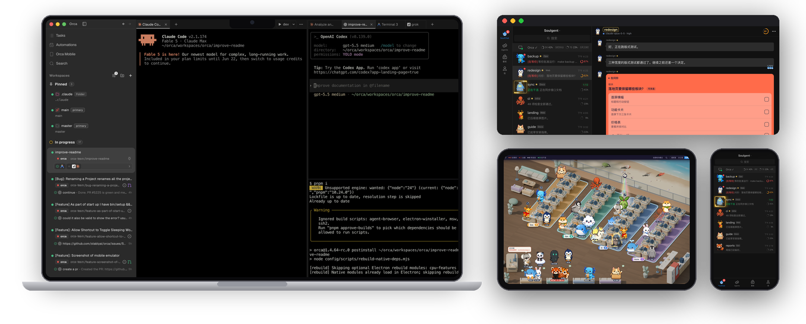</p>

<details>
<summary><b>作者的话：我为什么做 Soulgent</b>（点开看）</summary>

<br>

在 Claude Code、Codex、WorkBuddy 这些命令行或 App 里，我们都是对着界面开一个会话开始干活。我习惯让一个会话只处理一类事：一个帮我运维 VPS，一个帮我在手机上打游戏，一个帮我整理各个邮箱……

用得越久，会话越多。等我学会让 Claude Code 的会话互相发消息之后，管理会话本身成了瓶颈：要找某件事，就得翻很多会话，找来找去很麻烦。一开始我只顾得过来三四个，专心做一件事时，其余的就被忘在一边。

我看到很多人也在想办法：Reddit 上有人接了一盏实体警示灯，有人在 iPhone 上放了一个虚拟角色提醒自己。我这才意识到，我需要一套更好的交互来和 Agent 协作，因为拖慢人和 Agent 协作的，往往是我们人类自己。

现在有很多很强的产品，都在做一个无所不能的超级助手。我的习惯不一样：**我习惯一个会话做一类事。** 每个会话只管好自己那摊事的上下文，越用越懂行。

后来我的常驻会话超过了 40 个，有了面板也照顾不过来。于是我把它们分成 4 支 Agent 团队，每支有一位 Leader，大部分协作由 Leader 组织。以后团队可能更多，也许还得有一位"副总"来管 Leader。Soulgent 的三个画面就是这样一步步长出来的：**值班室**让我快速处理，**办公室**让伙伴走到我桌前汇报，**海景房**让一支支团队坐在一起。

现实里，我们会认识很多朋友，会在公司里和很多同事共事。以后，我们也会有很多 Agent。我希望会话能从命令行和对话框里走出来，让人和一群 Agent 相处，像和一群熟人相处一样自然。

</details>

## Soulgent 是什么

Soulgent 把你电脑上的每一个 Agent 会话，变成一个有名字、有样子、有情绪的角色。谁在干活、谁干完了有话说、谁在等你拍板，抬头一眼就知道。看所有会话的状态不需要别的软件；点角色跳到会话、在手机上回复，要配合 [Orca](#致谢) 使用。

干活时它们坐在桌前；干完有事汇报，就去沙发区等你；需要你拍板，就走到你桌前排队、敲门。整支队伍可以放在 iPad 上，按团队坐在一间海边办公室里；在 iPhone 上，像和朋友发消息一样回它们。

Soulgent 分两部分，看的是同一份实时会话状态：

- **Soulgent for Mac**：原生菜单栏 App + 悬浮窗口，可以放到 iPad 上常开，抬头看一眼所有伙伴的状态。在 `app/`，从源码编译。
- **Soulgent App**（手机网页 App）：添加到 iPhone 主屏幕的网页 App，里面的聊天页叫 SoulChat；离开工位时，像聊天一样回它们。在 `webapp/`，用 Docker 跑在你的 Mac 上。

<br>

## 点一下就到

点任何一个角色，Orca 直接跳到它的会话，并在窗格上盖一个大大的会话名，免得你看错。推荐这样摆：大屏开 Orca，正下方 iPad 开海景房（macOS 随航），手机开 Soulgent App。没有 iPad 的话，把 Soulgent 浮窗放在屏幕一角，或者在电脑浏览器里开 Soulgent App。

<picture><source srcset="docs/media/zh-CN/setup-jump.webp" type="image/webp">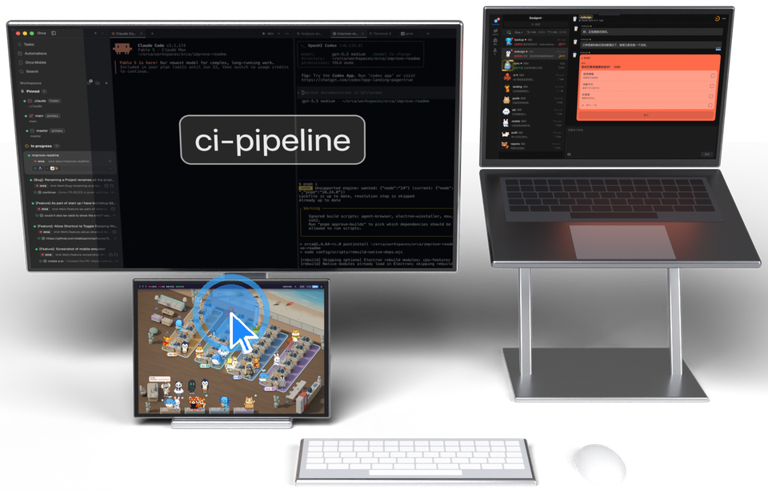</picture>

## 海景房

一间 Blender 渲染的海边办公室，四个岛坐着四支团队。

### 所有会话一间屋

你电脑上的每个会话都是这间海边办公室里的一个角色，坐在自己团队的岛上。Leader 固定坐最靠前的 1 号桌；岛上坐不下时，其余的人进休息室，团队牌上显示 +N。你在 [Orca](#致谢) 里打字的那个会话，头顶挂起一个迪斯科球；切换标签，它就跟过去。

<picture><source srcset="docs/media/zh-CN/seaview-spotlight.webp" type="image/webp">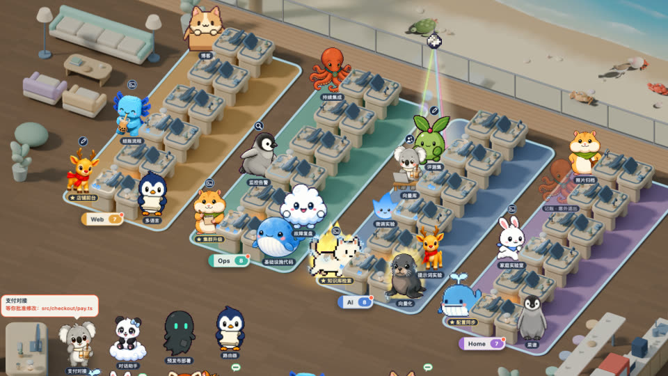</picture>

### 到你桌前排队、敲门

需要你拍板的会话走到你桌前排队，头顶写着它在等你做什么，每 3 秒敲一次门。你处理完，它走回去，下一个补上来。

<picture><source srcset="docs/media/zh-CN/seaview-queue.webp" type="image/webp"></picture>

### 桌边的子代理

会话派出子代理时，每个子代理都是桌边一个忙活的小人，活干完就离开。头顶的徽章告诉你这个会话正在用什么工具。

<picture><source srcset="docs/media/zh-CN/seaview-desk.webp" type="image/webp"></picture>

### Blaze Mode

只有用 Fable 模型的会话才会被点燃，抬头一看就知道现在有几个 Fable 在跑。它干活时身披火焰和闪电，空闲下来只剩一圈光晕。

判断方法是看会话的模型名里有没有 "fable"（不分大小写），只对 Claude Code 会话生效。设置里的「火焰与闪电附身」开关可以关掉它，默认是开的。

<picture><source srcset="docs/media/zh-CN/seaview-blaze.webp" type="image/webp"></picture>

### 虎鲸和沙滩

每隔几分钟，一头虎鲸冲上沙滩。螃蟹、鹬和海龟在沙滩上自己溜达，虎鲸一来就四散逃开，海鸥从头顶飞过。

<picture><source srcset="docs/media/zh-CN/seaview-orca.webp" type="image/webp"></picture>

### 串门

两个会话互发消息时，发话的一方起身走到对方桌边，一出发头顶就冒出它说的第一句话，在那儿串一会儿门。

<picture><source srcset="docs/media/zh-CN/seaview-visit.webp" type="image/webp">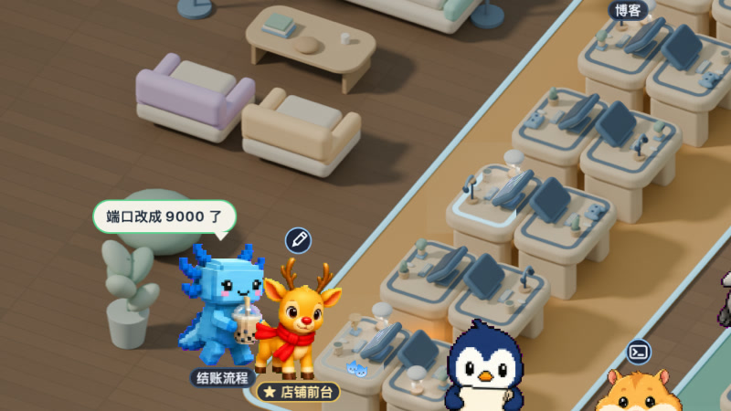</picture>

### 下班、报到、换座位

送下班的会话变成团队牌上的「下班」数字，点一下就能叫回来；还没分团队的新会话站在报到位。把人拖到别的桌子，或者右键给它换个角色。

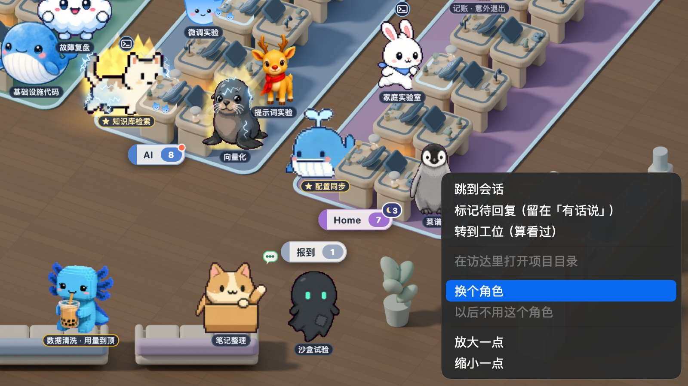

## 办公室

办公室和值班室是另外两个更简洁的画面，给用不到团队功能的人准备，两个画面都不分团队。

会话干完活，先在桌前蹦一下，再走到沙发上等着汇报；需要你的会话到你桌前排队。

<picture><source srcset="docs/media/zh-CN/office.webp" type="image/webp">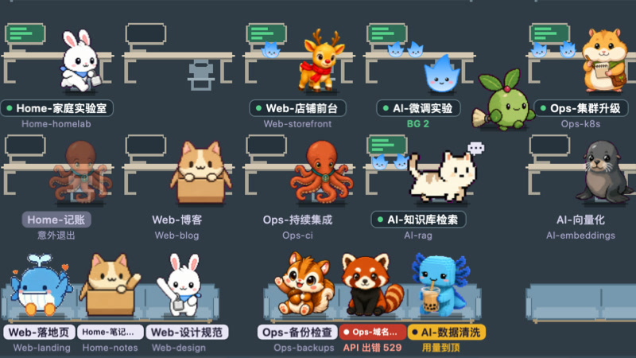</picture>

后墙的动态板记着谁干完了、谁在问你、谁找谁说了话；鼠标指到人物上，能看到它的卡片。

## 值班室

每个会话一张卡，按要你做什么分组。会话状态一变，卡片换到新的分组；一个会话给另一个发消息时，飞过一只纸飞机。

<picture><source srcset="docs/media/zh-CN/duty-room.webp" type="image/webp">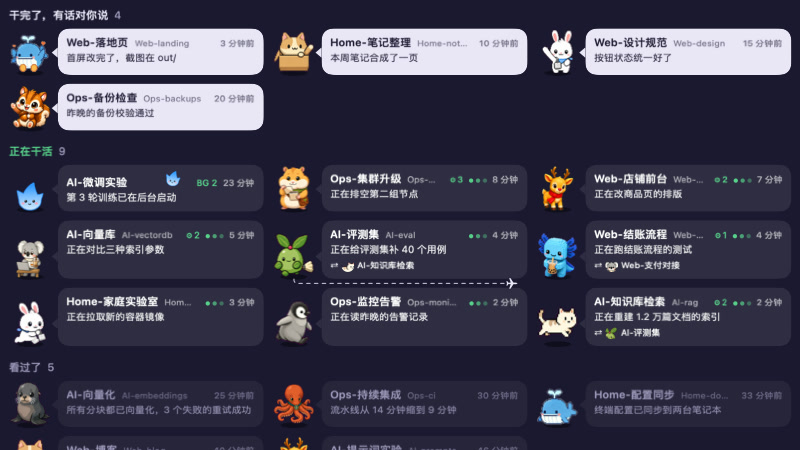</picture>

在等你的卡片上直接写着要你批的命令，或者它问的问题。窗口拉窄就成了一列收件箱，直接打字就能搜会话。

## Soulgent App（手机网页 App）

### 要你时会敲门

在等你拍板的会话会在列表里敲门、标红，列表再长也一眼看得到；每行末尾的小圆环是它的上下文用了多少。不属于任何团队的会话标「未分区」，干活时宠物自己走出头像，沿那一行来回溜达。

<picture><source srcset="docs/media/zh-CN/soulchat-knock-close.webp" type="image/webp">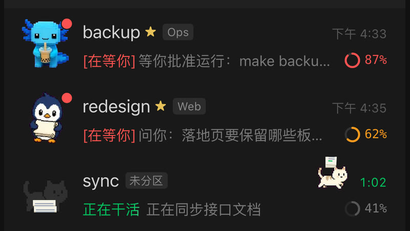</picture>

### 每个团队一种特效

有团队的会话干活时，头像播放这个团队的特效：环绕、跑马灯、光环或电路，在[团队表](#teams)里用 `fx` 设定。Leader 和组员表现一样，Leader 只多名字后的 ★。

<picture><source srcset="docs/media/zh-CN/soulchat-zone-fx.webp" type="image/webp">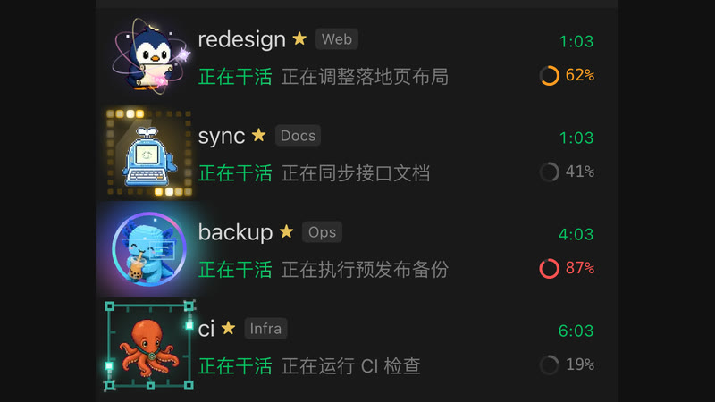</picture>

### 看它干活

工具在跑时，一个小人爬上对话气泡走来走去；工具跑完，它打个勾跳下来。

<picture><source srcset="docs/media/zh-CN/soulchat-tools-close.webp" type="image/webp">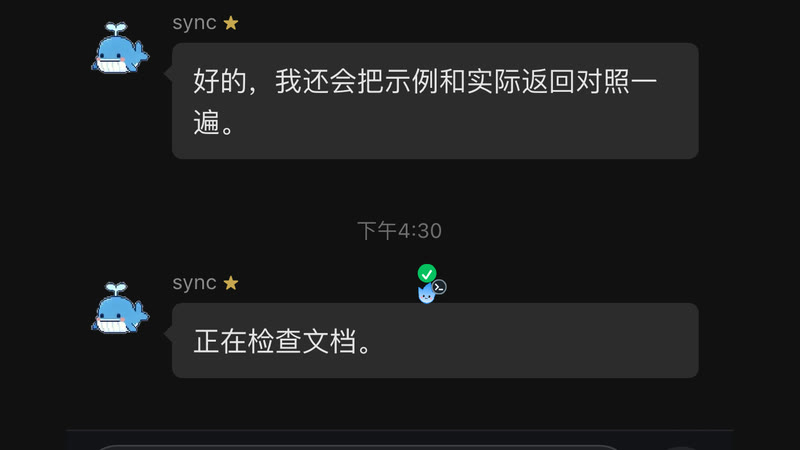</picture>

### 翻过来看子代理

会话派出子代理后，点一下那条消息，它翻到背面，每个子代理一张小卡片，写着状态和跑了多久；再点一下翻回来。

<picture><source srcset="docs/media/zh-CN/soulchat-agents-flip.webp" type="image/webp">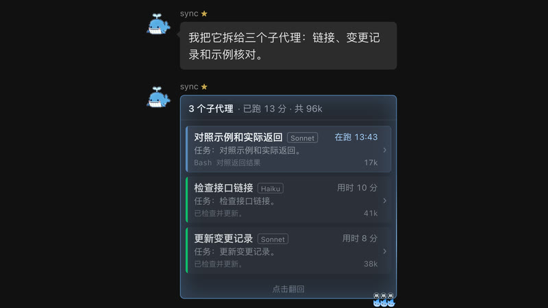</picture>

回复、答选择题、批准命令都在对话里完成，照片和文件也能互相发。推送只在你正在用的那台设备上响。在电脑浏览器里打开是左右两栏。

> **目前只能回复 Claude Code 会话**（开在 Orca 里的）。Codex 和 WorkBuddy 的会话在 Soulgent App 里只看得到状态和摘要，看不到完整对话，也还不能回复。

它跑在你自己的 Mac 上（Docker），通过局域网 HTTPS 访问。唯一会出你网络的是推送通知：加密后经 Apple 或 Google 的推送服务送到手机。拿到管理员密钥的人能往你的会话里打字，装之前请先看 [`webapp/README.md`](webapp/README.md) 里的安全说明。

## 支持的平台

| | Soulgent for Mac | Soulgent App（网页 App） |
|---|---|---|
| macOS | 原生 App | 服务跑在这里（Docker），也能在电脑浏览器里用 |
| iPhone / iPad | iPad 可以当 Mac 的显示器来看（随航） | 添加到主屏幕，支持推送通知 |
| Android | - | 用浏览器打开（没有原生 App） |
| Windows | 不支持 | 同一网络下用浏览器打开；服务端仍需要一台 Mac |

两部分都有简体、繁体、英文界面，跟随系统语言。

## 环境要求

必需：

- macOS 14 Sonoma 或更新版本，Apple Silicon。更早的版本没测试过。
- Xcode 命令行工具：第 1 步的 `git clone` 和编译都要用，不需要完整的 Xcode。运行 `xcode-select --install`，在弹窗里点「安装」（要输管理员密码，几分钟）；`xcode-select -p` 能打出路径就说明装好了。没有屏幕可点时，比如让 AI 经 SSH 代装，也先跑一次 `xcode-select --install`（这样更新列表里才会出现它），再用 `softwareupdate --list` 和 `sudo softwareupdate -i "<Command Line Tools 那一项的名字>"`。以后 Release 会附编好的 App，到时就不用装。
- [Claude Code](https://claude.com/claude-code)。没有它也能装上 Soulgent，只是屋里一直空着，等你开了会话才有人。
- Node.js 20 或更新（装 LTS 版就行），用来通过 [Petdex](https://petdex.dev) 安装角色：到 [nodejs.org](https://nodejs.org) 下载安装包（要输管理员密码），用 Homebrew 的话 `brew install node`。装完新开一个终端窗口，`npx` 才找得到。安装第 2 步要用。

可选，装了能多什么：

| 装了什么 | 多了什么 |
|---|---|
| [Orca](#致谢) | Claude Code 会话的点击跳转和聚光灯；在 Soulgent App 里回复、答选择题、批准命令（Orca 没开时消息先排队，开了再送进去） |
| Codex、WorkBuddy | 它们的会话也会出现在 Soulgent for Mac 和 Soulgent App 里，点一下用它们自己的 App 打开；在手机上只看得到状态和摘要，看不到完整对话，也不能回复 |
| Docker | 运行 Soulgent App |

## 安装

分四步：装 App → 装角色 → 组团队 → 打开海景房。手机上的 Soulgent App 可选，放在后面。

Soulgent 就在你 clone 下来的那个文件夹里运行，开机自启也指向那里。请把它放在一个固定的位置，别放在「下载」「桌面」「文稿」里。以后要挪，就在新位置重新运行一次 `tools/install.sh`，带上原来的 `--finder` 和 `--root`。

### 推荐：让 Claude Code 或 Codex 帮你装

如果你已经在用 Claude Code 或 Codex，在你放代码的文件夹里打开它，把下面这段贴给它：

```text
按 https://github.com/Ericcc0321/soulgent/blob/main/README.zh-CN.md 的「安装」一节帮我装 Soulgent。
先检查环境要求，必需项缺什么装什么；要输密码的步骤先问我。
第 1 步之前先问我：项目放在哪个文件夹、要不要 Finder 标签、用不用 Orca。
四步都做，角色用推荐的那一套。
第 3 步先问我想把会话分成哪几个团队（最多四个）、各由谁当 Leader，再替我写好 ~/.claude/workzones.json，并告诉我会话该怎么起名。
最后问我要不要再装手机上的 Soulgent App。
```

想自己动手的话，步骤如下：

### 第 1 步：装 App

```bash
git clone https://github.com/Ericcc0321/soulgent.git
cd soulgent
app/build.sh                # 编译 Soulgent.app
tools/install.sh --finder   # 现在启动并开机自启，带 Finder 标签（不要标签就去掉 --finder）
```

编译要几分钟，会刷一屏编译警告，这是正常的；最后一行是 `built Soulgent.app` 就成功了。想确认 Soulgent 在运行，`pgrep -x Soulgent` 会打出一个数字。

Finder 标签默认在 `~/Projects`、`~/Developer`、`~/code` 里找项目文件夹（三个都不存在时，安装脚本会提醒你）；放在别处的话用 `tools/install.sh --finder --root <文件夹>` 指定（可以写多个 `--root`）。「文稿」「桌面」「下载」里的文件夹受 macOS 保护，后台打不了标签，项目请放在别处，比如 `~/Projects`。

聚光灯要配合 [Orca](#致谢)。第一次打开聚光灯时，macOS 会请你在 **系统设置 > 隐私与安全性 > 辅助功能** 里允许 Soulgent；不用 Orca 就用不到这个权限。要卸载，见[卸载](#uninstall)。

### 第 2 步：装角色

Soulgent 自带一个角色：灵火。乐趣在其他角色身上。下面这条命令装上作者自己在用的一整套，来自 [Petdex](https://petdex.dev)，清单在 [`examples/pets.txt`](examples/pets.txt)（约 175 MB，一到几分钟；可以按喜好增删）：

```bash
tools/install-pets.sh
```

Petdex 上还有 5000 多个，想加哪个就 `npx -y petdex@latest install <id> <id> ...`。角色装在 `~/.petdex/pets/` 里，Petdex 还会在 `~/.codex/pets/` 给 Codex 放一份（两份合计约 350 MB）。新装的一分钟内出现。Petdex 默认会发匿名使用统计，用 `npx petdex telemetry off` 关掉。

<a id="teams"></a>
### 第 3 步：组团队

海景房按团队排座。跳过这一步，所有会话都会挤到角落的报到点，所以请在打开海景房之前做好。团队在配置里叫**工区**。每个团队有一位 **Leader**，坐 1 号桌，组员用 2 到 12 号桌。

1. **会话按 `工区-系统-任务` 起名**，例如 `Web-auth-flow`、`Docs-api-reference`。启动时用 `claude --name`，或在会话里用 `/rename`。第一个 `-` 前面的部分要和工区表里的工区键一字不差（区分大小写）。
2. **写一份工区表 `~/.claude/workzones.json`**。从 [`examples/workzones.example.json`](examples/workzones.example.json) 复制一份，把示例团队换成你自己的，用不上的删掉：

   ```bash
   mkdir -p ~/.claude
   cp examples/workzones.example.json ~/.claude/workzones.json
   ```

   示例长这样：

   ```json
   {
     "default": null,
     "zones": {
       "Web":   { "name": "Web",   "color": "#4A90D9", "order": 1, "lead": "Web-lead",  "fx": "orbit" },
       "Docs":  { "name": "Docs",  "color": "#E0A030", "order": 2, "lead": "Docs-lead", "fx": "marquee" },
       "Infra": { "name": "Infra", "color": "#A070D0", "order": 3, "lead": null,        "fx": "halo" },
       "Ops":   { "name": "Ops",   "color": "#50B080", "order": 4, "lead": null,        "fx": "circuit" }
     },
     "dirs": {
       "~/code/docs-site": "Docs"
     }
   }
   ```

   - `lead`：这个团队 Leader 的完整会话名，要一字不差。Leader 不在线或没配（`null`）时，1 号桌空着。
   - `name`：团队牌上的名字。海景房先找同名的岛（岛上画的是 Web、Ops、AI、Home）。
   - `dirs`：会话名没有可识别的前缀时，按项目目录归区（最长前缀匹配）。`~` 代表你的主目录，不支持通配符。用不上就写 `{}` 或者整项删掉。
   - `default`：`dirs` 也对不上时归到哪个工区；`null` 表示不归区。不归区的会话去场景角落的报到点；其中在等你的，会到你桌前排队。
   - `color`：团队牌的颜色。`order`：`name` 找不到同名岛的团队，按这个顺序坐空着的岛。
   - `fx`：这个团队的会话干活时，Soulgent App 里头像播放的特效：`orbit` 环绕、`marquee` 跑马灯、`halo` 光环、`circuit` 电路。不写的话，宠物会自己走出头像。
3. **可选：在 [Orca](#致谢) 里开 Claude Code 会话。** 聚光灯和点击跳转靠它（聚光灯还要辅助功能权限）。Codex 和 WorkBuddy 的会话用它们自己的 App 跳转，不需要 Orca。

海景房有四个岛，最多放四个团队（以后的版本可能会加更多）：

- 不到四个时，空岛挂一块 0 人的牌。
- 超过四个时，第五个起的团队暂时不显示。
- 每个团队最多 12 张桌子，再多的人进休息室，牌子上显示 +N。

值班室和办公室两个画面不分团队。改了工区表，几秒内就生效，不用重启。

**常见的静默出错**：这些写法不会报错，只是效果不对。

- JSON 写错：整份表当空表处理。
- `zones` 写成数组：所有会话都不归区。
- `color` 不是 6 位十六进制：牌子变灰。
- `order` 写成字符串：排到最后。
- `lead` 只写了名字的一部分：1 号桌一直空着。

### 第 4 步：打开海景房

Soulgent 第一次打开是值班室，窗口较小。把窗口拖大（宽约 860、高约 550 就够），然后在标题栏右边的切换里点**海景房**，或者在菜单栏菜单里选（窗口太小时那一项是灰的，写着「窗口再大一些才显示」）。开一个按你的团队起名的 Claude Code 会话（在 Orca 或任何终端里都行），比如保留了 Web 团队的话就叫 `Web-auth-flow`，几秒内它就会走到那个团队的岛上落座。想一直看着海景房，就把窗口拖到当副屏的 iPad 上（随航）；它会记住这块屏，iPad 重新连上后自己回去。

没有屏幕可点，比如让 AI 经 SSH 代装？用下面几条命令切到海景房（主题的 id 就是中文「海景房」，照原样输入）。窗口仍然要够大，这需要有人在屏幕前把它拖大：

```bash
defaults write io.github.ericcc0321.soulgent officeTheme 海景房
defaults write io.github.ericcc0321.soulgent office -bool true
launchctl kickstart -k gui/$(id -u)/io.github.ericcc0321.soulgent
```

<a id="uninstall"></a>
### 卸载

只跑 `tools/uninstall.sh` 只会退出 Soulgent、去掉开机自启。要删干净，在 `soulgent` 文件夹里按顺序运行：

```bash
python3 tools/finder/finder_sessions.py --restore   # 用过 --finder 才需要；它要用到数据目录，所以先跑
tools/uninstall.sh                                  # 退出 Soulgent，去掉开机自启
rm -rf ~/Library/Application\ Support/Soulgent ~/Library/Caches/io.github.ericcc0321.soulgent
defaults delete io.github.ericcc0321.soulgent
rm -f ~/Library/Preferences/io.github.ericcc0321.soulgent.plist
```

最后删掉 `soulgent` 文件夹。角色不会自动删，因为 Petdex 和 Codex 也在用：不想要了就删 `~/.petdex/pets`；`~/.codex/pets` 只在你不用 Codex 宠物时再删。`~/.claude/workzones.json` 是你自己写的，留不留随你。

## 安装 Soulgent App（可选）

需要 Docker，服务端跑在装了 Soulgent 的那台 Mac 上。

```bash
cd webapp
cp .env.example .env        # 填管理员密钥、Mac 的局域网 IP 等
docker compose up -d
bash helper/install.sh      # 小帮手：在 Mac 上读会话状态给 Soulgent App
/usr/bin/python3 -m pip install --user Pillow   # 只需一次：切图跑在 Mac 自带的 Python 上
/usr/bin/python3 tools/build_pets.py            # 把已装的 Petdex 宠物切进 data/pets/
```

不做最后两步，头像全是内置灵火。装了新宠物后重跑 `build_pets.py`，详见 [webapp/docs/pets.zh-CN.md](webapp/docs/pets.zh-CN.md)。

然后在 iPhone 上信任根证书、添加到主屏幕。完整步骤和每个配置项的说明见 [`webapp/README.md`](webapp/README.md)。

## 工作原理

- 会话：Soulgent 每 2 秒读一次 Claude Code 在 `~/.claude/sessions/` 里的运行会话列表，`~/.claude/projects/` 里的对话记录有变化时读它的末尾。这些是 Claude Code 的内部格式，Claude Code 升级可能导致失效。
- Codex 和 WorkBuddy：在它们的 App 运行时，只读方式读取它们自己的本地数据库。
- 聚光灯和点击跳转：在本机和 Orca 通信。辅助功能权限只用来读 Orca 的标签栏。
- 团队（工区）：来自 `~/.claude/workzones.json`，写法见[安装第 3 步](#teams)。
- 日志和数据：在 `~/Library/Application Support/Soulgent/`。
- 联网：Soulgent for Mac 运行时不发任何网络请求，只在本机和 Orca 通信。Soulgent App 在你自己的局域网里提供服务，只有推送通知会加密后经 Apple 或 Google 的推送服务出去。安装时会从 GitHub、npm（Petdex）和 Docker Hub 下载。Petdex 默认发匿名使用统计，运行 `npx petdex telemetry off` 可以关掉。

## 团队协作：我目前的做法（仅供参考）

这部分借鉴自 eisen0419 的 [Claude Code 工作流复刻指南](https://gist.github.com/eisen0419/7301766c8e4f8d94315ba603deb74154)。我在这基础上搭了一套比较简单的配置，自己也还在摸索，社区里比我做得好的人很多。如果你也想让会话之间互相交接、协作，下面只是一个起点。Soulgent 只会读其中的下班名册，而且要配好名册位置才读（设置项 `rosterFile` 或环境变量 `SOULGENT_ROSTER_FILE`），其余的它都不读。

- 全局 `CLAUDE.md`：写清你是谁、怎么沟通、哪些事必须先问你。
- 输出风格（output style）：作者用的是"白话协作"，规定回复先说结论、要你拍板的事用选项弹出来，Soulgent 才能把它显示成"在等你"。回复里以 `〔进度〕` 开头的一行，会成为这个会话卡片上的一句话状态。
- 交接文档：每个项目一份 `HANDOFF.md` 写"现在是什么样"，一份 `HISTORY.md` 写"每次做了什么"。新窗口先读它，再接着干。
- 换窗：状态栏把上下文用量写到磁盘，hook 在用到一半时提醒收尾；收尾后由脚本通过 Orca 把会话以同一个名字重开成新窗口，并把最后一条发言交给新窗口。触发它的是我自建的 `/window` 命令，不是 Claude Code 自带的。
- Leader 和组员的规矩：每个团队一份规则文件，会话启动时由 hook 按会话名注入。Leader 派活必写目标、不在范围、验收标准；组员回报只写三行：结果、产出、缺口；组员转述的"用户批了"不算数，要用户本人确认。
- 下班和唤醒：闲置太久的会话自动退出、记进名册。配好名册位置后，团队牌会显示下班人数；再把 `offDutyScript` 设成唤醒脚本，就能把它们叫回来。

这些部件以后也许会整理成模板。

### 参考

- 换窗提醒、状态栏记录上下文用量、交接文档里"等你的事当场记下"，借鉴自 eisen0419 的 [Claude Code 工作流复刻指南](https://gist.github.com/eisen0419/7301766c8e4f8d94315ba603deb74154)（议题驱动、换窗接续、多 agent 协作），想自己搭一套的话值得整篇读。
- 输出风格的结构参考了 eisen0419 的 `CLAUDE.md`。

## 设置

所有设置都在设置窗口里（标题栏的齿轮，或菜单栏菜单里的 `⌘,`）：字号、聚光灯、办公室主题、海景房特效、每个会话用哪个角色，以及诊断工具。设置存在 App 的 user defaults 里，键名和默认值见 `app/Settings.swift`。

## 开发

- Mac App：`app/test.sh` 编一份检查用的程序并跑全部检查，最后一行是 `all passed`。想在 Xcode 里浏览或编译代码，在 `app/` 下跑 `swift build`；这样编出的程序没有 bundle id、读不到设置，要运行请用 `app/build.sh`。
- Soulgent App，在 `webapp/` 下（Python 3.11 或更新、Node 22）：

  ```bash
  python3 -m pip install -r api/requirements.txt
  python3 -m unittest discover -s tests -t .
  node --test web/tests/*.test.mjs
  ```

截图、性能检查这类维护者脚本在 `app/tools/dev/`（见其中的 README）。每次推送，GitHub Actions 会自动跑 Soulgent App 的检查。参与开发见 [CONTRIBUTING.md](CONTRIBUTING.md)，安全问题见 [SECURITY.md](SECURITY.md)。

## 目录结构

```
app/                    macOS App（Swift，AppKit + SwiftUI）
  brand/                标志、吉祥物和菜单栏图标
  themes/seaview/       海景房渲染图和精灵图
  build.sh, test.sh
  tools/dev/            维护者用的脚本（截图、性能检查），见其中的 README
launchd/                开机自启模板（由 tools/install.sh 填好）
tools/                  install.sh, uninstall.sh, install-pets.sh
  finder/               可选的 Finder 标签工具
examples/               工区表示例、推荐宠物清单
docs/media/             README 配图
webapp/                 Soulgent App，手机网页 App（Docker：api + Caddy，外加 Mac 上的小帮手）
```

## 关于作者

我不是专业开发者，是一个有点子的兴趣爱好者，[Claude Code](https://claude.com/claude-code) 给了我把点子做出来的能力。Soulgent 来自我每天同时用很多 Agent、希望它们更"活"一点的念头。欢迎提想法、提 issue、提 PR。

## 致谢

- **[AI超元域](https://www.aivi.fyi/)**：我看这位博主的博客和视频，学会了很多用 AI 的技巧。
- **[Petdex](https://github.com/crafter-station/petdex)**（[petdex.dev](https://petdex.dev)）：除自带的灵火外，所有角色都来自这个开放的宠物库。每个角色的美术归其作者所有，Soulgent 不附带、也不重新授权其中任何内容。
- **[Orca](https://github.com/stablyai/orca)**（[orca.dev](https://orca.dev)）：在我看来是目前最好用的 ADE（Agent 开发环境），同时驾驭一群编程 Agent，也是 Soulgent 跳转和聚光的对象。开头主图里的 Orca 画面取自 Orca 的 README（MIT 许可，Copyright (c) 2026 Lovecast Inc.）。
- **[eisen0419](https://gist.github.com/eisen0419/7301766c8e4f8d94315ba603deb74154)**：换窗和交接的做法，以及输出风格的结构，见[参考](#参考)。
- Anthropic 的 **[Claude Code](https://claude.com/claude-code)**，以及 Codex 和 WorkBuddy，Soulgent 显示的就是它们的会话。

- 本项目在 [Claude Code](https://claude.com/claude-code) 协助下开发，提交记录里保留了它的共同作者标记。

## 许可

[MIT](LICENSE) © 2026 Ericcc0321。`app/themes/` 和 `app/brand/` 里的美术都由本项目自己的脚本生成，同样按 MIT 发布，详见 [`app/themes/ASSETS.md`](app/themes/ASSETS.md)。
